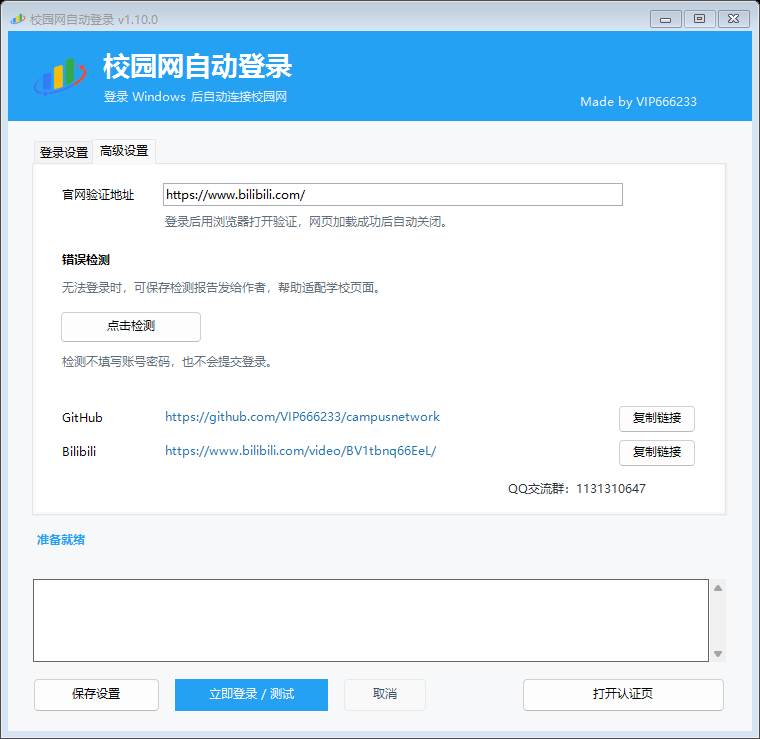

<div align="center">

# 校园网自动登录

**进入 Windows 桌面，校园网自动连接。**

自动填写账号密码 · 自动匹配登录页面 · 选择运营商 · 验证网络 · 托盘驻留

**v1.10.0** · Windows 10 / 11 · C# + JavaScript · [MIT 开源](LICENSE)

[📥 下载软件](#download) · [🚀 从零开始](#guide) · [🔍 登录问题](#help) · [🛠 源码与编译](#development) · [⭐ 支持项目](#support)

</div>

---

<a id="download"></a>
## 📥 下载软件

文件名：**`校园网自动登录_v1.10.0.zip`**。两个网盘提供同一个版本，任选其一。

| 下载方式 | 链接 | 提取码 |
| --- | --- | --- |
| 百度网盘 | [点击下载 v1.10.0](https://pan.baidu.com/s/1Ms4TSAjZVwjAtFL3dt65bw?pwd=ruqe) | `ruqe` |
| 中国移动云盘 | [点击下载 v1.10.0](https://yun.139.com/shareweb/#/w/i/2yA8FEmponAjc) | — |

中国移动云盘链接也可复制后打开手机 App 使用。压缩包内附有 [从零开始使用教程](校园网自动登录_从零开始使用教程.txt)。

> **更新旧版：** 先右键通知区域里的软件图标，选择“退出”，再解压运行新版。换了软件存放位置后，重新保存设置，以更新开机启动路径。

## 🆕 v1.10.0 最近更新

| 更新 | 使用时的变化 |
| --- | --- |
| 三套页面规则合并 | 通用表单、华电区域表单、图片登录按钮表单合到一个软件，按页面特征自动匹配，不用手动选学校。 |
| 更快关闭认证网页 | 提交后的结果检查间隔从 1.5 秒缩短至 0.2 秒；确认成功后关闭网页，再继续网站验证。实际耗时取决于网页响应。 |
| 高级设置简化 | 移除一排手动适配输入框，保持自动识别；遇到问题可通过“点击检测”保存报告。 |
| 项目链接与交流群 | 高级设置可打开、复制 GitHub 和 Bilibili 链接，点击 QQ 群号即可复制。 |
| 标题与说明统一 | 软件标题只显示软件名和版本号；软件包、源码包都附带从零开始教程。 |

目前的适配针对上述已知页面，并非所有学校都已支持。华电的空白区域处理需要学校标识与表单特征同时匹配，不会直接套用到其他学校。

## ✨ 主要功能

| 功能 | 说明 |
| --- | --- |
| 自动连接 | 登录 Windows 后先等待网络就绪，再等待设置的时间，默认 3 秒。 |
| 运营商选择 | 支持识别校园网、中国移动、中国联通、中国电信，按你的实际选择登录。 |
| 同次完成跳转 | 认证入口跳转到学校服务器后，继续识别和登录，无需再次点击。 |
| 网络验证 | 登录后用独立浏览器访问指定网站，完成后自动关闭；默认验证地址为 Bilibili。 |
| 结果通知 | 右下角弹窗显示运营商与验证结果，支持滑入、滑出动画。 |
| 托盘驻留 | 关闭主窗口后留在通知区域，双击图标可重新打开。 |
| 设置保存 | 修改设置后点击连接、关闭窗口或退出，会询问是否保存；密码按当前 Windows 用户加密保存。 |

<details>
<summary><strong>🖼 查看 v1.10.0 界面预览</strong></summary>

高级设置保留验证地址、错误检测、项目链接和交流群。以下为使用默认配置生成的实际界面，不含真实账号。



</details>

<a id="guide"></a>
## 🚀 从 0 开始使用

### 0. 准备软件

解压下载的压缩包到一个长期保存的位置，然后双击 `校园网自动登录.exe`。

### 1. 设置 Windows 网络连接

- 使用 Wi-Fi 时，在 Windows 网络设置中只为校园网勾选“在范围内时自动连接”；其他网络取消自动连接。
- 使用网线连接校园网时，关闭 Wi-Fi。

### 2. 填写登录信息

在软件“登录设置”中确认本校认证地址，填写校园网账号和密码，并在“运营商”中选择实际使用的网络：校园网、中国移动、中国联通或中国电信。

### 3. 设置开机自动登录

勾选“开机自动登录（进入 Windows 桌面后）”。“启动等待”保持默认的 **3 秒** 即可。

### 4. 保存设置

点击“保存设置”。以后修改设置时，点击连接、关闭窗口或退出会询问是否保存：

- **是**：保存并继续。
- **否**：本次使用修改，但不保存。
- **取消**：返回软件继续修改。

### 5. 第一次登录

点击一次“立即登录 / 测试”，不要连续点击。软件会自动打开认证页面、填写账号密码、选择运营商并提交。等待软件完成登录和验证即可。

### 6. 查看登录结果

右下角弹窗会显示所选运营商和登录结果：

- 显示“www.bilibili.com官网登录成功”等：表示验证网页已成功加载，网络已确认连接；更换地址后会显示对应域名。
- 显示“未进行官网验证”：表示认证页已完成，但官网验证未完成。
- 显示“连接网络失败”：请检查网络、账号、密码和运营商选择后再试。

### 7. 开机自动登录

开机进入 Windows 桌面后，软件会先等待网络连接，再自动执行登录。登录完成后软件会隐藏到右下角通知区域，并弹出结果提示，不需要再次点击“立即登录 / 测试”。

### 8. 打开或退出软件

- 双击右下角通知区域的小图标：重新打开软件窗口。
- 关闭窗口：隐藏到通知区域，软件继续运行。
- 完全退出：右键通知区域图标，选择“退出”。

### 9. 修改验证地址

如需更换测试网站，打开“高级设置”，修改“官网验证地址”，填写完整网址后保存。

默认验证地址：<https://www.bilibili.com/>


这里的“官网登录成功”指验证网站能正常访问，并不表示登录了该网站的用户账号。

<a id="help"></a>
## 🔍 登录遇到问题

先确认电脑已连接校园网，并能在平时的浏览器中打开本校认证页。软件无法识别时：

1. 打开“高级设置”，点击 **“点击检测”**。
2. 等认证页加载完整；如果有运营商下拉菜单，可以展开后点击“重新检测”。
3. 保存检测报告，通过 [GitHub Issues](https://github.com/VIP666233/campusnetwork/issues) 或 QQ 交流群 `1131310647` 反馈。

检测只读取页面结构，不填写账号密码、不点击登录；报告不采集输入框内容、Cookie、浏览器存储或网址查询参数。附截图时请隐藏自己的账号等个人信息。

认证阶段最多等待 40 秒；超时、浏览器被关闭或认证失败后会尝试网站验证。认证页面仍不可确认且验证网站无法访问时，会提示连接失败。

<a id="development"></a>
## 🧩 代码与项目属性

| 属性 | 说明 |
| --- | --- |
| 源码版本 | v1.10.0 |
| 开发语言 | C#（兼容 C# 5）+ JavaScript |
| 界面框架 | Windows Forms（WinForms） |
| 运行环境 | Windows 10 / 11、.NET Framework 4.8 |
| 浏览器依赖 | Microsoft Edge 或 Google Chrome |
| 自动化方式 | 通过浏览器 DevTools 协议识别并填写认证页面 |
| 页面适配 | 按页面特征自动匹配三套规则，提交后固定本次规则，不因失败轮流重复提交密码 |
| 密码保存 | Windows DPAPI 加密，与当前 Windows 用户绑定 |
| 构建方式 | PowerShell 脚本，无需 NuGet 依赖 |
| 开源许可证 | [MIT](LICENSE)，允许使用、修改和分发，需保留版权及许可证声明 |

项目以作者提供的 v1.9.1 EXE 恢复源码为基础，v1.10.0 合入华电和图片按钮页面适配、快速关闭及简化的高级设置。来源和验证记录见 [源码说明](SOURCE_PROVENANCE.md)。此版本未合入休眠唤醒重连。

<details>
<summary><strong>📁 源码结构</strong></summary>

| 文件 / 目录 | 作用 |
| --- | --- |
| `src/MainForm.cs` | 主界面、设置与托盘操作 |
| `src/PortalRouter.js` | 自动识别并选择页面适配规则 |
| `src/adapters/` | 通用、华电和图片按钮页面的登录规则 |
| `src/Portal.js` | 构建时生成的完整认证脚本 |
| `src/LoginService.cs` | 登录流程、页面跳转与超时处理 |
| `src/BrowserSession.cs` | 浏览器启动与自动化控制 |
| `src/ConnectivityCheck.cs` | 验证网站访问结果 |
| `src/LoginNotification.cs` | 右下角弹窗及动画 |
| `src/PortalDiagnosticsForm.cs` | 登录页结构检测和报告导出 |
| `src/Settings.cs` | 设置存储、密码加密与开机启动配置 |
| `src/assets/` | 软件图标和 Logo |
| `tests/` | 登录、网页验证及浏览器通信测试 |
| `build.ps1` / `build-portal.ps1` | 编译软件及合成认证脚本 |
| `package.ps1` | 打包软件和源码，自动附带教程 |

</details>

### 🔧 自行编译

下载源码并解压，在项目根目录打开 Windows PowerShell，执行：

```powershell
powershell.exe -NoProfile -ExecutionPolicy Bypass -File .\build.ps1
```

编译结果位于 `dist` 文件夹，包含软件、配置文件和使用教程。运行时将 EXE 与同名 `.exe.config` 文件放在一起。修改适配逻辑请编辑 `src/PortalRouter.js` 或 `src/adapters/`，再重新构建。

需要生成软件和源码压缩包时运行 `package.ps1`，发布约定见 [RELEASING.md](RELEASING.md)。

仓库配置了 [GitHub Actions](https://github.com/VIP666233/campusnetwork/actions)，提交后执行编译与回归测试。v1.10.0 已通过 90 项本机浏览器融合检查及相关流程、验证和通信检查；这不等同于每所学校的实网验证。

<a id="support"></a>
## ⭐ 求一颗小星星

**喜欢可以支持一下↑  ヾ(≧▽≦*)o**

如果这个工具帮你省去了每天手动登录的麻烦，欢迎点击页面右上角的 **Star**，给项目一点支持，也方便以后找到更新。

- ⭐ **[GitHub 项目](https://github.com/VIP666233/campusnetwork)**：点个 Star，也欢迎分享给需要的同学。
- 🪙 **[Bilibili 视频](https://www.bilibili.com/video/BV1tbnq66EeL/)**：欢迎投币、点赞支持。
- 💬 **QQ 交流群：`1131310647`**：交流使用问题、反馈学校页面兼容情况。

---

<div align="center">

由 **VIP666233** 制作 · [MIT License](LICENSE)

</div>
